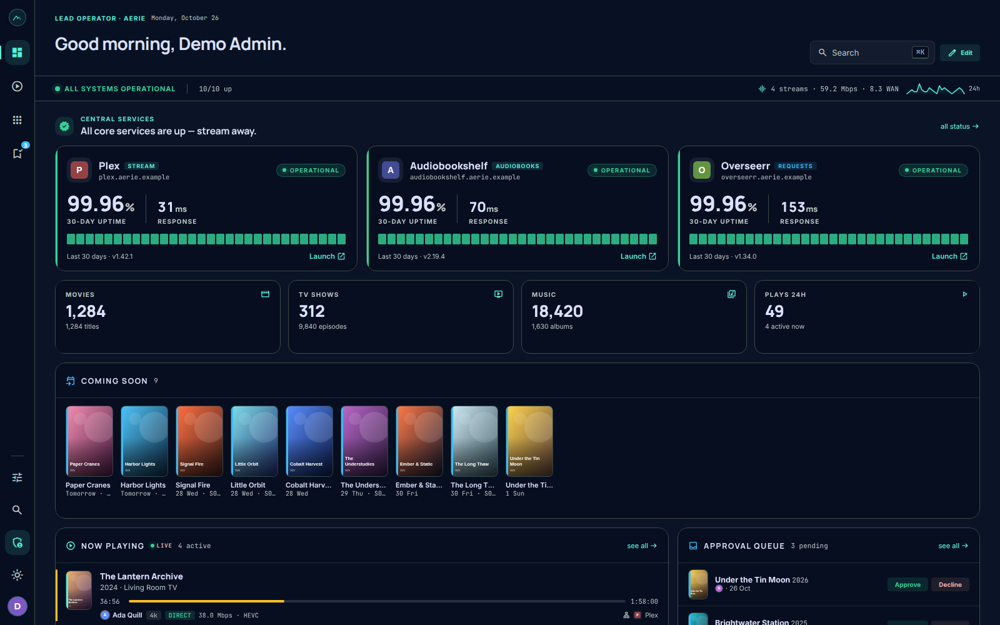
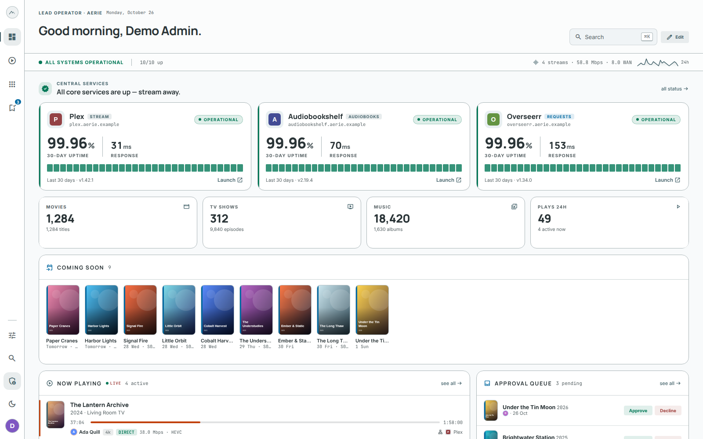

<p align="center">
  <picture>
    <source media="(prefers-color-scheme: dark)" srcset="./docs/assets/aerie-logo-dark.svg">
    
  </picture>
</p>

<p align="center"><em>Media Command Center — every service, one vantage point.</em></p>

<p align="center">
  <a href="https://github.com/s3ntin3l8/media-dashboard/actions/workflows/ci.yml"></a>
  <a href="./LICENSE"></a>
</p>

<p align="center">
  
  
</p>
<p align="center"><sub>Captured from the scripted demo with fictional titles; see <a href="#demo-and-screenshots">Demo and screenshots</a>.</sub></p>

A private media portal for self-hosted services (Plex, Jellyfin, Overseerr, the *arr suite,
Tautulli/Jellystat, Gatus, Prometheus, Beszel), exposed behind Traefik and authenticated via **any
OIDC provider** (or a local admin account when OIDC is off). One vantage point to reach
every service, see unified media stats, manage per-user requests, and watch uptime.

Built with **Next.js (App Router, TypeScript)**.

## Status

| Area | State |
|---|---|
| Frontend | Dark/light, ⌘K palette, keyboard nav, admin/member preview, responsive |
| Auth | Auth.js v5; any OIDC provider or local credentials; role from `groups` claim or `AERIE_ADMIN_EMAILS`; route protection |
| Persistence | SQLite + Drizzle (services, secrets, groups, visibility, users, links, prefs); migrations + seed |
| Secrets | AES-256-GCM at rest (`ENCRYPTION_KEY`) |
| Integrations | Gatus, Tautulli, Jellyfin, Audiobookshelf, Overseerr, Sonarr/Radarr, Prowlarr, Bazarr, NZBHydra2, Listenarr, NZBGet, qBittorrent, Wizarr, Agregarr, Prometheus, Beszel clients; real-data-or-empty per panel |
| Service insight | Read-only **Traefik** (route health, "behind SSO", TLS-cert expiry + discovered-router add) and **Authentik** (per-app group access) correlated by host — see `docs/services/` |
| Live data | `/api/snapshot` polled by the client; now-playing/status stay fresh, incl. a live now-playing chip in the embed header |
| Cover art | Tautulli/Jellyfin/ABS proxy (`/api/artwork`) with placeholder fallback |
| Embedding | Real `<iframe>` + Traefik `frame-ancestors` middleware + OIDC forward-auth (`docs/EMBEDDING.md`) |
| Admin | Add/edit/remove **service modal** (wired to `upsertService`/`setServiceSecret`/`deleteService`), persisted visibility matrix |
| Requests | **Request modal** (member discover→confirm→submit) + **review modal** (admin approve/decline); real Overseerr search/create/review when configured |
| Deploy | Standalone Dockerfile + `docker-compose.yml` behind Traefik (`docker-compose.traefik.example.yml` is the security-reviewed internet-facing reference); `.env.example` |

## Configure for production

1. `cp .env.example .env` and fill in OIDC provider creds (or leave `OIDC_*` unset for
   local-admin mode), `AUTH_SECRET`, `ENCRYPTION_KEY`.
2. `npm run db:migrate && npm run db:seed` (or let the runtime bootstrap do it).
3. Enter each service's API key in **Admin → Services** (stored encrypted) to light up live
   data; services without a key show an empty state until configured. Per-service setup
   (credential format, what each surfaces) is documented in [`docs/services/`](docs/services/README.md).
4. Deploy with `docker compose up -d` behind Traefik; apply the embed + forward-auth
   middlewares to embeddable services (see `docs/EMBEDDING.md`). For an internet-facing
   deployment, follow [`docker-compose.traefik.example.yml`](docker-compose.traefik.example.yml)
   — the security-reviewed reference topology (proxy-network-only, HTTPS + HSTS, OIDC,
   X-Forwarded-For hygiene).

### Host metrics: Prometheus or Beszel

The admin **System Status** page renders host metric cards (CPU, memory, network, disk, load,
uptime, filesystems). Two interchangeable sources can fill them:

- **Prometheus** — `apiKey` optional (only for bearer auth); a node/instance picker scopes the query.
- **Beszel** — its hub is PocketBase, so it needs credentials. Set the `beszel` service's **API key to
  `email:password`** (packed; split on the first `:`) for a Beszel **superuser** — that reads every
  monitored system without per-system sharing, matching the Homepage widget convention. Create one with
  `docker exec beszel /beszel superuser upsert you@example.com 'your-password'`. A system picker chooses
  which host to display.

When **both** are configured, a **Prometheus ⇄ Beszel toggle** appears in the section header (default
Prometheus). The active source and selected system/instance persist as deployment settings
(`metricsSource`, `beszelSystem`, `prometheusInstance`).

## Develop

```bash
npm install
npm run dev      # http://localhost:3001
npm run build    # production build + typecheck + lint
npm run start    # serve the production build
```

## Demo and screenshots

`npm run screenshots` (or `make screenshots`) regenerates the images in `docs/screenshots/` from a
fully scripted, throwaway demo. Aerie shows live upstream data or an empty state, with no mock
fallback, so the demo boots a fake upstream (`scripts/demo/upstream.mjs`) that stands in for
Tautulli, Overseerr, Sonarr, Radarr, Gatus, Prometheus and NZBGet and serves a fictional catalogue
(`scripts/demo/catalog.mjs`) with generated poster art. A scratch SQLite database is provisioned
from a generated `aerie.yaml`, `next dev` runs against both on dedicated loopback ports, a
throwaway admin is created through the first-run setup form, Playwright captures the screens, and
everything is torn down.

| Command                          | What it does                                                                                            |
| -------------------------------- | ------------------------------------------------------------------------------------------------------- |
| `make demo`                      | The same demo instance, left running; prints a URL and writes a throwaway login to a private file.      |
| `make screenshots-landing OUT=…` | 2x dark stills plus a short live-dashboard loop (webm/mp4/poster) for a project page; needs `ffmpeg`.   |

One-time setup for the browser: `npx playwright-core install chromium`. On a slow or heavily loaded
host, raise `DEMO_HEALTH_TIMEOUT_MS` (default `90000`), the time each readiness probe may take.
`DEMO_WEB_PORT` (default `3930`) and `DEMO_UPSTREAM_PORT` (default `3931`) move the ports.

**Isolation is enforced, not assumed** (`scripts/demo/env.mjs`, tested in
`tests/unit/demo-env.test.ts`): the demo process gets a clean environment with nothing inherited
except `PATH`/locale, all state lives in one temp directory that is deleted afterwards, Next.js is
told to skip its `.env*` files (so a real `.env` is never read), both ports must be free, and the
guard refuses to start if any database, path, secret or service URL points outside the scratch
directory or off loopback. The browser is held to the same rule: any request that is not loopback
fails the capture.

## Layout

```
app/
  (portal)/            authenticated shell (rail + ⌘K palette)
    page.tsx           Home dashboard
    services/          service launcher
    s/[service]/       embed / launch service view
    requests/  status/  admin/
  login/               OIDC handoff or local-admin sign-in
components/
  primitives.tsx       Icon, Btn, Pill, Heartbeat, Sparkline, PosterTile, …
  panels.tsx           NowPlaying, ServiceTiles, CentralServices, Status, …
  portal/              PortalProvider (theme/role/palette), Rail, CommandPalette
  views/               Home, Launcher, Requests, Status, Admin, Login, shared
lib/
  types.ts             domain types
  categories.ts        static service category taxonomy
styles/                colors_and_type.css · components.css · fonts.css + fonts
```

## Contributing / quality gates

Four gates must pass before merging: `lint`, `typecheck`, `test`, and `build`. CI runs them on every push and PR to `main`; the pre-push Husky hook runs them locally.

```bash
npm install               # installs hooks via the prepare script
npm run lint
npm run typecheck
npm run test
npm run build
```

See [`CONTRIBUTING.md`](CONTRIBUTING.md) for the full workflow, testing patterns, and migration guide.

## Security

Report vulnerabilities privately — see [`SECURITY.md`](SECURITY.md).

## Operations

Backup/restore, `ENCRYPTION_KEY` rotation, deployment update, health check, and full env-var reference: [`docs/OPERATIONS.md`](docs/OPERATIONS.md).

## License

Copyright (C) 2026 Björn Hansen

This program is free software: you can redistribute it and/or modify it under
the terms of the GNU Affero General Public License as published by the Free
Software Foundation, either version 3 of the License, or (at your option) any
later version. See [LICENSE](LICENSE).
